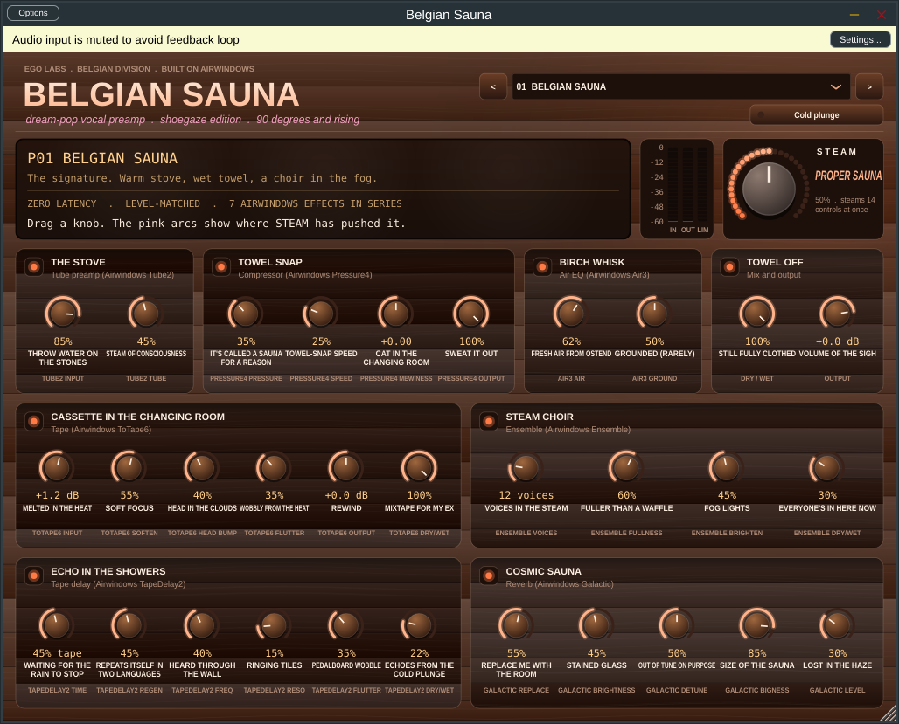

# Belgian Sauna

A dream-pop and shoegaze vocal preamp. Seven classic [Airwindows](https://github.com/airwindows/airwindows) effects run in series, each with its own joke dial: tube warmth, gentle compression, air, cassette tape, a choir of voices, a wobbly tape echo and an enormous reverb. One big **STEAM** knob moves them all at once.



## Download it

Go to this repo's **Releases** page (on the right, or `/releases`):

| File | What it's for |
|---|---|
| `BelgianSauna-Windows-App.zip` / `-Mac-App.zip` | The standalone app. Open it and sing. |
| `BelgianSauna-Windows-VST3.zip` / `-Mac-VST3.zip` | The plug-in for Ableton, FL Studio, Cubase, Reaper, Studio One, Bitwig |
| `BelgianSauna-Mac-AU.zip` | The plug-in for Logic and GarageBand |
| `...-AAX-unsigned.zip` | Pro Tools. Works in Pro Tools Developer, or in regular Pro Tools once it's signed with Avid's PACE tools. |

**Singing into the app**
1. Unzip it and open it.
   - **Windows:** click **More info → Run anyway** the first time.
   - **Mac:** if macOS blocks it, go to System Settings → Privacy & Security, click **Open Anyway**, then allow the microphone.
2. Put headphones on so you don't get feedback.
3. Go to **Options → Audio/MIDI Settings** and pick your mic or interface.
4. Click the yellow "input muted" bar to unmute, and sing.

**Installing the plug-in**
- Windows VST3: copy it to `C:\Program Files\Common Files\VST3`
- Mac VST3: copy it to `/Library/Audio/Plug-Ins/VST3`
- Mac AU: copy it to `/Library/Audio/Plug-Ins/Components`

Then rescan plug-ins in your DAW. Belgian Sauna has **zero latency**, so it's fine to sing through live.

## The rooms

| Section | Airwindows effect | What it does |
|---|---|---|
| The Stove | Tube2 | Tube preamp warmth |
| Towel Snap | Pressure4 | Smooth compression |
| Birch Whisk | Air3 | Breathy top-end air |
| Cassette in the Changing Room | ToTape6 | Tape saturation, softening and flutter |
| Steam Choir | Ensemble | A choir of slightly detuned copies of you |
| Echo in the Showers | TapeDelay2 | Wobbly, filtered tape echo |
| Cosmic Sauna | Galactic | Huge, detuned shoegaze reverb, on a send so your dry voice stays put |
| Towel Off | (ours) | Dry/wet and output |

- **STEAM.** At 0% you get a dry room: the colour stays, but the echo, choir and reverb are off. At 50% the knobs are exactly as set. At 100% everything floats. The pink arcs show where STEAM has pushed each knob, and the output is trimmed as it rises so more steam never just means louder.
- **Level matching.** The tube, compressor and tape stages change the tone without changing the volume.
- **Cold plunge** is bypass, and your DAW's bypass button triggers it too.

**Presets:** Belgian Sauna · Heaven or Ostend · Loveless in Leuven · Fog Over Ghent · Whisper in the Changing Room · Tape from the Attic · Antwerp Cathedral · Dry Towel

## Build it yourself

You need CMake 3.22 or newer. JUCE 9.0.4 downloads automatically.

```bash
# Mac (needs Xcode)
cmake -S . -B build -G Xcode && cmake --build build --config Release
# Windows (needs Visual Studio 2022)
cmake -S . -B build -G "Visual Studio 17 2022" -A x64 && cmake --build build --config Release
```

To use **Projucer** instead, install JUCE 9, point Projucer's Global Paths at it, open `BelgianSauna.jucer` and export to Xcode or Visual Studio.

Every push to `main` builds Windows and Mac versions on GitHub and publishes them to Releases (`.github/workflows/build.yml`).

### How the Airwindows code is included

The seven effects in `Source/airwindows/` are Chris Johnson's original files, unmodified. They were written as VST2 plug-ins, so `audioeffectx.h` is a small stand-in written for this project, not Steinberg code, that gives them the few functions they expect. Each effect compiles in its own `Unit_*.cpp`, so their names never clash. To add another effect, copy its folder from the Airwindows repo, add a `Unit_` file and a factory, and wire it into `SaunaEngine.h`.

### Tested

- The engine test (`SaunaEngineTest`) renders all 8 presets at STEAM 0%, 50% and 100%, at 44.1, 48 and 96 kHz. It checks for no NaNs, no overs, levels within ±12 dB of the input, and decaying tails. All pass.
- The Linux VST3 passes **pluginval at strictness 10**, including editor, state, automation, thread-safety and fuzz tests.
- Windows and Mac builds come from GitHub Actions.

## Credits and licence

- **Airwindows** effects by Chris Johnson, MIT licence. See `Source/airwindows/LICENSE-airwindows.txt` and [airwindows.com](https://www.airwindows.com). Support him on Patreon if you like these sounds.
- Built with **JUCE**, under JUCE's licence. It's free under AGPLv3, or under the JUCE Starter licence up to $20k a year in revenue.
- Belgian Sauna's own code (engine glue, controls, faceplate) is by Fin, with Claude.
